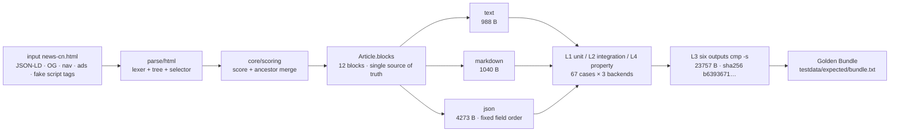

# content-kit

[](https://github.com/UNKN0WNi/content-kit/actions/workflows/ci.yml) · [](./LICENSE)

🌐 **Language / 语言:** **English** · [简体中文](./README.md)

> A cross-backend content extraction and normalization kernel — **one MoonBit codebase produces JS / WASM / WASM-GC / native artifacts whose output is byte-for-byte identical.**

> The [quick-testing guide](./docs/real-world-testing.en.md) and [example walkthrough](./examples/README.en.md) are bilingual too. [STEPS.md](./STEPS.md), [SPIKE.md](./SPIKE.md), [CHANGELOG.md](./CHANGELOG.md) and the UI of [docs/test-visual.html](./docs/test-visual.html) are currently Chinese-only. All commands, code, API names and measured results in this README are language-independent.

Built from `PLAN.md` (content-kit project plan v0.1). Implementation steps and per-step acceptance records: [STEPS.md](./STEPS.md); S0 feasibility results: [SPIKE.md](./SPIKE.md).

---

## In one sentence

Turn any web page into **clean body text + structured data**. The extraction algorithm, rule table and domain model are written once; a browser extension, an edge Worker, a server-side archiver and a CLI all share the same implementation — **consistency is guaranteed by construction, not by manual alignment**.

---

## Quick start

```bash
# 1. Full verification (format check + four-backend check + three-backend test suite)
bash scripts/test-all.sh

# 2. Build all four backends + record artifact sizes
bash scripts/build-all.sh

# 3. Cross-backend byte-for-byte consistency comparison (L3)
bash scripts/consistency.sh

# 4. Golden Vector snapshot regression
bash scripts/golden.sh

# 5. npm package build + Node smoke test
bash scripts/package-npm.sh
```

The toolchain is portable and needs no installation: the scripts automatically add the workspace's `.tools/moonbit` directory to `PATH` and set `MOON_HOME`. If `moon` is already installed system-wide, that one is used instead.

### CLI

```bash
# Golden Bundle over all corpus cases (name<TAB>JSON, one per line)
bash scripts/cxtract.sh

# Extract a local HTML file
bash scripts/cxtract.sh page.html --format json
bash scripts/cxtract.sh page.html --format text
bash scripts/cxtract.sh page.html --format md

# Pipe / inline input
cat page.html | bash scripts/cxtract.sh --format json
bash scripts/cxtract.sh --text '<article><p>...</p></article>' --format md

# Select a backend (js / wasm / wasm-gc; native requires a host C compiler)
CXTRACT_TARGET=wasm bash scripts/cxtract.sh page.html

# Misc
bash scripts/cxtract.sh --list
bash scripts/cxtract.sh --rules-version
bash scripts/cxtract.sh --help
```

### npm / Node

```js
import { extractJson, extractText, extractMd, rulesVersion } from "content-kit";

const article = JSON.parse(extractJson(html));   // Article
const text = extractText(html);                  // plain text
const md = extractMd(html);                     // Markdown
```

`js/index.d.ts` ships complete TypeScript declarations (including `Article` / `ContentBlock`).

### MoonBit

```moonbit
import { "contentkit/extract" @extract }

let article = @extract.extract(html)        // -> Article
let json = @extract.extract_json(html)     // fixed-schema JSON
let text = @extract.extract_text(html)
let md = @extract.extract_md(html)
```

---

## Architecture

```
┌──────────── core/ (zero deps, 100% backend-agnostic) ────────────┐
│ article.mbt   Block / Metadata / Article                          │
│ rules.mbt     single source of truth for weights + rules_version   │
│ features.mbt  8 features per candidate block                      │
│ scoring.mbt   §5.5.3 scoring formula (pure function)              │
│ text.mbt      whitespace folding / entity decode / safe truncation │
│ metadata.mbt  §5.5.4 metadata precedence                          │
│ json.mbt      deterministic JSON escape + fixed 4-decimal output   │
└──────────┬──────────────────────────┬────────────────────────────┘
           │                          │
  parse/html/                  parse/plain/
  small HTML lexer + tree       plain-text / email fallback
  minimal selector subset              ↓
  tag/.class/#id/[attr]                ↓
  descendant combinator / :not()        ↓
           └──────────┬───────────┘
                      ▼
        extract/ facade + three renderers + Golden Bundle
                      │
      ┌───────────────┼────────────────┬─────────────┐
      ▼               ▼                ▼             ▼
   cli/ (native)  js/ (npm esm)   wasm/ (wasm/gc)  testdata/
```

**Three hard constraints**:

1. `core/` contains no backend-specific import (ADR-2).
2. Every magic number appears exactly once, in `core/rules.mbt` (ADR-1).
3. `text` / `markdown` / `json` are rendered only from the same `Article.blocks` (ADR-3).

---

## Why the four backends are byte-identical by construction

| Layer | Approach |
|---|---|
| Compile-time | `core/` `parse/` `extract/` have no `targets` restriction — all four backends compile the same source |
| Serialization | **No runtime `Json` value**: field order is hard-coded in `render_json.mbt`; floats are emitted as fixed 4-decimal values using integer arithmetic; string escaping has one implementation (D2 Plan B) |
| Rules | The rule table is code and ships with the version; `rules_version` is exposed publicly |
| Corpus | 14 built-in snapshots (Chinese/English, news/blog/docs/forum, JSON-LD, entities, malformed HTML, fake tags inside `<script>`, plain text, Unicode surrogate pairs) |
| Verification | `scripts/consistency.sh` runs `cmp` over 6 outputs (js/wasm/wasm-gc CLI, npm ESM, wasm package entry, Golden file) — **zero difference required** |

Measured on this machine: all 6 outputs are **23,757 bytes and byte-for-byte identical**.

---

## Artifact matrix

| Artifact | Backend | Path | Measured size | Budget |
|---|---|---|---|---|
| `contentkit.js` (ESM, with `.d.ts`) | js | `js/dist/contentkit.js` | 157,784 B | ≤ 400 KB ✅ |
| `cli.js` | js | `_build/js/.../cli/cli.js` | ~155 KB | — |
| `cli.wasm` | wasm | `_build/wasm/.../cli/cli.wasm` | 167 KB | ≤ 500 KB ✅ |
| `cli.wasm` | wasm-gc | `_build/wasm-gc/.../cli/cli.wasm` | 99 KB | ≤ 500 KB ✅ |
| `cxtract` | native | needs MSVC/gcc to link | — | ≤ 3 MB |

Full size records: [BENCHMARKS.md](./BENCHMARKS.md).

---

## API

### `extract(html) -> Article`

```
Article {
  title, byline?, site_name?, excerpt?, lead_image?, lang?, published_at?,
  blocks : Array[Block],       // ordered content sequence
  text, markdown,              // rendered from blocks
  metadata : Metadata,
  score : Double,
  rules_version : String
}
```

`Block` = `Paragraph | Heading(level,text) | ListItem | Quote | Code | Image(src,alt?)`.

### Metadata precedence (§5.5.4)

| Field | Precedence |
|---|---|
| title | JSON-LD `headline` > `og:title` > `twitter:title` > `<title>` > first `h1` |
| byline | JSON-LD `author` > `meta[name=author]` > `.byline/.author` |
| site_name | `og:site_name` > JSON-LD `publisher` > hostname |
| excerpt | JSON-LD `description` > `og:description` > `meta[name=description]` > truncated first paragraph |
| lead_image | `og:image` > JSON-LD `image` > first `` |
| published_at | JSON-LD `datePublished` > `article:published_time` > `<time datetime>` |
| lang | `<html lang>` > `http-equiv=content-language` |

### Scoring model

```
score = base_weight(tag) + 1.0*min(commas,3) + 0.5*min(paragraphs,3)
      + 0.5*min(text_len/100,3) + 0.5*min(link_len/100,3)
      - 0.25*min(link_len/paragraphs,3) - 0.5*min(10*class_weight,3)
      + 0.25*min(10*id_weight,3) + 0.5*min(10*role_weight,3)
```

Take the highest-scoring block → merge low-scoring ancestors upward (`parent_score > 0.2 * child_score`) → drop siblings with `score < 0` → emit in document order.

---

## Tests

Four test layers, **67 cases**, all passing on the three runnable backends `js` / `wasm` / `wasm-gc`:

| Layer | Coverage |
|---|---|
| L1 unit | `core/` scoring/normalization/JSON/metadata precedence, HTML lexer and tree building, 6 selector forms, plain-text parsing, renderers, CLI argument layer |
| L2 integration | 14 corpus end-to-end snapshots, metadata precedence, three-views-single-source, JSON field order, black-box public API tests |
| L3 consistency | `consistency.sh` runs `cmp` over six outputs with zero difference |
| L4 property | 120 deterministic malformed-HTML mutations + `quickcheck` (100/50 cases) checking "never crash + invariants + idempotence" |

```bash
moon test --target js       # Total tests: 67, passed: 67
moon test --target wasm     # Total tests: 67, passed: 67
moon test --target wasm-gc  # Total tests: 67, passed: 67
```

### Host limitation (important)

The reference machine runs Windows **without MSVC / clang-cl**. MoonBit's native backend requires an MSVC-compatible compiler to **link an executable**, therefore:

- ✅ `moon check --target native` (part of the four-backend typecheck) passes;
- ✅ `moon build --target native core parse/html parse/plain extract testdata` (pure libraries) passes;
- ✅ native test code (`*_wbtest.mbt`) is written and is picked up automatically by `test-all.sh` once MSVC/gcc is installed;
- ❌ the link step of `moon build --target native` and `moon run --target native` are unavailable on that machine.

This is a **missing host compiler**, not a code defect: the same source passes `moon check --target all` on all four backends. `consistency.sh` probes for a C compiler and includes native in the byte comparison when one is available.

---

## Visual test walkthrough

> **Interactive page**: [docs/test-visual.html](./docs/test-visual.html) — a single file with zero external dependencies, light/dark adaptive; just double-click to open it offline. (UI text is in Chinese.)
> All 67 test names, 13 assertions, 14 corpus cases and 6 output SHA-256 values are **read from real repository artifacts by `scripts/gen-test-visual.py`**, not hand-drawn sample data. Run `bash scripts/consistency.sh`, then `python scripts/gen-test-visual.py` to refresh the page with the latest measurements.

### How one case passes through all four layers



### Example: `L2 news-cn end to end`

The input is the built-in `news-cn` corpus case: a Chinese news page with JSON-LD, Open Graph, navigation, an ad slot and fake tags inside `<script>`. Real assertions from `extract/extract_wbtest.mbt` (comments added for explanation; Chinese string literals are kept verbatim):

```moonbit
test "L2 news-cn end to end" {
  let html = @testdata.case_html("news-cn").unwrap()
  let a = extract(html)
  assert_eq(a.title, "来自 JSON-LD 的标题")   // JSON-LD headline beats og:title / <title>
  assert_eq(a.byline, Some("赵岩"))           // JSON-LD author
  assert_eq(a.site_name, Some("每日科学"))    // og:site_name
  assert_eq(a.lang, Some("zh-CN"))
  assert_eq(a.published_at, Some("2026-11-14"))
  assert_eq(a.lead_image, Some("https://example.com/moon.jpg"))
  assert_true(a.blocks.length() >= 6)        // measured: 12 blocks, score = 13.25
  assert_eq(@core.contains_sub(a.text, "我国首个月球科研基地"), true)
  assert_eq(@core.contains_sub(a.text, "这段脚本里的伪标签"), false)
  assert_eq(@core.contains_sub(a.text, "广告位招租"), false)
  assert_eq(@core.contains_sub(a.text, "版权所有 每日科学"), false)
  assert_eq(a.rules_version, "1.0.0")
  assert_true(article_invariants(a))
}
```

**Measured output** (all three views come from the same `Article.blocks`, taken verbatim from Golden line 1):

| View | Size | Starts with |
|---|---|---|
| Input HTML | 1,936 chars | `<!DOCTYPE html>` … `<script type="application/ld+json">` |
| `text` | 988 B | `月球基地开始运行` |
| `markdown` | 1,040 B | `# 月球基地开始运行` |
| `json` | 4,273 B | `{"title":"来自 JSON-LD 的标题","byline":"赵岩",…}` |

```bash
bash scripts/cxtract.sh --case news-cn --format text   # plain text
bash scripts/cxtract.sh --case news-cn --format md     # Markdown
bash scripts/cxtract.sh --case news-cn --format json   # structured
```

### Six outputs, one hash (L3)

```
moon run --target js       cli  ┐
moon run --target wasm     cli  │
moon run --target wasm-gc  cli  ├─→ 23,757 B ─→ cmp -s all identical
Node · ESM goldenBundle()       │                 sha256 b6393671dee9e065…
moon run --target wasm     wasm ┘
testdata/expected/bundle.txt (Golden)  ←── comparison baseline
```

Tail of a real `bash scripts/consistency.sh` run:

```text
OK   cli-wasm.txt       (23757 bytes)
OK   cli-wasm-gc.txt    (23757 bytes)
OK   npm-esm.txt        (23757 bytes)
OK   entry-wasm.txt     (23757 bytes)
OK   bundle.txt         (23757 bytes)
CONSISTENCY OK: 6 outputs are byte-identical (23757 bytes each)
```

### What you can click on the page

| Area | Interaction | Test layer |
|---|---|---|
| "▶ Run the example" | 13 assertions light up one by one; 6 flow nodes advance in sync | L1 / L2 |
| Output tabs | Switch between input HTML and the full real text / Markdown / JSON | ADR-3 single source |
| "▶ Start comparison" | 6 outputs turn green one by one with SHA-256 and byte counts | L3 |
| Case distribution bars | Expand all 67 real test names grouped by package | L1 / L2 / L4 |
| Corpus matrix | 14 rows; click one to see its JSON prefix | L2 snapshot |

### Reproduce

```bash
bash scripts/test-all.sh             # 67/67 × 3 backends
bash scripts/consistency.sh          # 6 outputs, zero difference
bash scripts/golden.sh               # Golden snapshot
python scripts/gen-test-visual.py    # refresh docs/test-visual.html with latest measurements
```

---

## Real-world page walkthrough

> **Quick-testing guide for every environment**: [docs/real-world-testing.en.md](./docs/real-world-testing.en.md) ([中文](./docs/real-world-testing.md)) · Scripts and artifacts: [examples/README.en.md](./examples/README.en.md) ([中文](./examples/README.md))

Instead of built-in synthetic corpus cases, run the entire pipeline on **any real web page**: fetch → three-backend extraction → three output views → byte-for-byte comparison → caller-side cleanup → a local visual page.

```bash
bash examples/run.sh --fetch "https://example.com/some-article"  # fetch any page (or save it as examples/page.html)
bash examples/run.sh                          # one command: 3-backend compare + Node demo + local visual page
node examples/demo.mjs examples/page.html --clean   # caller-side cleanup comparison
```

**The page snapshot is not committed.** Real pages contain copyrighted body text, ad images and inline base64 blobs; a public repository should distribute the method, not the content. `.gitignore` excludes `examples/page.*` (the page and all extraction artifacts) and `docs/realworld-demo.html` (a visual page that embeds the body). What ships in the repository is the generic `run.sh` / `demo.mjs` / `gen-realworld-demo.py` scripts plus the bilingual guide, so any site produces the same report in three commands.

The guide covers 10 invocation paths: CLI on the default js backend, wasm / wasm-gc backends, file/pipe input, Node ESM, browser-only front end, direct MoonBit calls, WASI / moonrun, native binaries, and a corpus-only smoke test that needs no real page.

| One local measurement (real finance news page; snapshot not committed) | Result |
|---|---|
| Input | rendered DOM, 528,481 B (UTF-8) |
| Extraction | 35 content blocks (33 paragraph + 2 image), `score = 7.14` |
| Three views | `text` 12,470 B / `markdown` 12,534 B / `json` 39,646 B |
| Three backends | `js` / `wasm` / `wasm-gc`: 39,647 B each, all sha256 `170b6ea9ab8109f1…`, `cmp` shows zero difference |
| App-layer cleanup | 4 noise blocks dropped; body text 12,470 B → 5,487 B (31 body paragraphs kept) |

Typical limits on real pages (see guide §3/§4 for the troubleshooting table): `byline = null` when only `article:author` is present; `lang = null` when `<html>` has no `lang`; an empty `og:image` falls back to the first ``, which may be a default avatar; body tails may include inline base64 images, ad images and site footers. `demo.mjs --clean` shows how a caller re-renders filtered `blocks` **without changing the kernel**.

---

## Explicit non-goals

As defined in plan §3.3 / §4.4: no crawler, summarization, LLM calls, JavaScript execution, general-purpose DOM library, full CSS selector support, browser extension product itself, image processing, or CSS layout engine. v1.0 directions: full JSON-LD, configurable rule tables, WIT components, language detection, reading time.

---

## Decision records (deviations from the plan)

| Decision | Plan | This implementation | Rationale |
|---|---|---|---|
| D1 HTML/selectors | reuse `moonbit-community/html` + `mizchi/css` | **Plan B: minimal self-built subset** | Offline reproducibility, seamless DOM integration, no external deps on any backend |
| D2 JSON | `moonbitlang/core/json` | **Plan B: hand-written fixed-schema serializer** | Eliminates cross-backend differences in float formatting, field order and escaping |
| D3 algorithm | custom rule table | custom rule table | Consistent with ADR-1 |
| Input I/O | direct file reads | CLI args + environment-variable channel | One `main` works on Node / moonrun(WASI) / native, avoiding backend-specific FFI |

---

## License

Apache-2.0, see [LICENSE](./LICENSE). The algorithmic idea is inspired by Mozilla Readability (Apache-2.0); no source code was copied from it.
