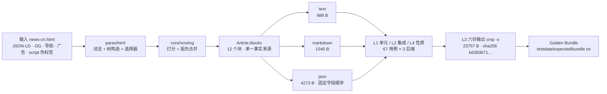

# content-kit

[](https://github.com/UNKN0WNi/content-kit/actions/workflows/ci.yml) · [](./LICENSE)

🌐 **语言 / Language:** **简体中文** · [English](./README.en.md)

> 跨端内容抽取与规范化内核 —— **一份 MoonBit 源码，产出 JS / WASM / WASM-GC / 原生四套产物，输出逐字节一致。**

> 英文版见 [README.en.md](./README.en.md)，章节结构与命令一一对应；[各环境快速测试指南](./docs/real-world-testing.md) 也有 [English](./docs/real-world-testing.en.md) 版。[STEPS.md](./STEPS.md)、[SPIKE.md](./SPIKE.md)、[CHANGELOG.md](./CHANGELOG.md) 与 [docs/test-visual.html](./docs/test-visual.html) 的界面目前仅提供中文。

依据 `PLAN.md`（content-kit 项目计划书 v0.1）实现。实现步骤与逐项验收记录见 [STEPS.md](./STEPS.md)，S0 预研结论见 [SPIKE.md](./SPIKE.md)。

---

## 一句话定位

把任意网页变成「干净正文 + 结构化数据」。抽取算法、规则表、领域模型只写一次；浏览器扩展、边缘 Worker、服务端归档、CLI 共享同一份实现，**一致性由构造保证，而不是由人工对齐保证**。

---

## 快速开始

```bash
# 1. 全套验证（格式化 + 四后端 check + 三后端全量测试）
bash scripts/test-all.sh

# 2. 四后端产物构建 + 体积记录
bash scripts/build-all.sh

# 3. 跨后端逐字节一致性比对（L3）
bash scripts/consistency.sh

# 4. Golden Vector 快照回归
bash scripts/golden.sh

# 5. npm 包产出 + Node 冒烟测试
bash scripts/package-npm.sh
```

工具链是绿色免安装的：脚本会自动把工作区 `.tools/moonbit` 加入 `PATH`，并设好 `MOON_HOME`；系统已装 `moon` 时直接用系统的。

### CLI

```bash
# 全量语料 Golden Bundle（名称<TAB>JSON，逐行）
bash scripts/cxtract.sh

# 抽取一个本地 HTML 文件
bash scripts/cxtract.sh page.html --format json
bash scripts/cxtract.sh page.html --format text
bash scripts/cxtract.sh page.html --format md

# 管道 / 内联
cat page.html | bash scripts/cxtract.sh --format json
bash scripts/cxtract.sh --text '<article><p>...</p></article>' --format md

# 指定后端（js / wasm / wasm-gc；native 需宿主有 C 编译器）
CXTRACT_TARGET=wasm bash scripts/cxtract.sh page.html

# 其它
bash scripts/cxtract.sh --list
bash scripts/cxtract.sh --rules-version
bash scripts/cxtract.sh --help
```

### npm / Node

```js
import { extractJson, extractText, extractMd, rulesVersion } from "content-kit";

const article = JSON.parse(extractJson(html));   // Article
const text = extractText(html);                  // 纯文本
const md = extractMd(html);                     // Markdown
```

`js/index.d.ts` 提供完整 TypeScript 声明（含 `Article` / `ContentBlock`）。

### MoonBit

```moonbit
import { "contentkit/extract" @extract }

let article = @extract.extract(html)        // -> Article
let json = @extract.extract_json(html)     // 固定 schema JSON
let text = @extract.extract_text(html)
let md = @extract.extract_md(html)
```

---

## 架构

```
┌──────────────── core/ （零依赖、100% 后端无关）────────────────┐
│ article.mbt   Block / Metadata / Article                        │
│ rules.mbt     所有权重与阈值的单一事实来源 + rules_version       │
│ features.mbt  候选块的 8 项特征                                │
│ scoring.mbt   §5.5.3 打分公式（纯函数）                        │
│ text.mbt      空白折叠 / 实体解码 / Unicode 安全截断            │
│ metadata.mbt  §5.5.4 元数据优先级                              │
│ json.mbt      确定性 JSON 转义 + 定点 4 位小数                 │
└──────────┬──────────────────────────┬──────────────────────────┘
           │                          │
  parse/html/                  parse/plain/
  轻量 HTML 词法+树构造          纯文本 / 邮件兜底
  最小选择器子集                 ↓
  tag/.class/#id/[attr]          ↓
  后代组合/:not()               ↓
           └──────────┬───────────┘
                      ▼
            extract/ 门面 + 三输出渲染 + Golden Bundle
                      │
      ┌───────────────┼────────────────┬─────────────┐
      ▼               ▼                ▼             ▼
   cli/ (native)  js/ (npm esm)   wasm/ (wasm/gc)  testdata/
```

**三条硬约束**：

1. `core/` 不出现任何后端相关 import（ADR-2）。
2. 所有魔数只在 `core/rules.mbt` 出现一次（ADR-1）。
3. `text` / `markdown` / `json` 只能从同一个 `Article.blocks` 渲染（ADR-3）。

---

## 为什么四后端输出必然逐字节一致

| 层 | 做法 |
|---|---|
| 编译期同源 | `core/` `parse/` `extract/` 不设 `targets` 限制，四后端编译的是同一份源码 |
| 序列化 | **不使用运行时 `Json` 值**：字段顺序硬编码在 `render_json.mbt`；浮点用整数运算输出固定 4 位小数；字符串转义统一实现（D2 Plan B） |
| 规则 | 规则表是代码，随版本走；对外暴露 `rules_version` |
| 语料 | 14 篇内置快照（中/英、新闻/博客/文档/论坛、JSON-LD、实体、畸形 HTML、script 伪标签、纯文本、Unicode 代理对） |
| 验证 | `scripts/consistency.sh` 对 6 份输出（js/wasm/wasm-gc CLI、npm ESM、wasm 包入口、Golden 文件）做 `cmp`，**必须零差异** |

实测结果（本机）：6 份输出 **均为 23,757 字节，逐字节相同**。

---

## 产物矩阵

| 产物 | 后端 | 路径 | 实测体积 | 预算 |
|---|---|---|---|---|
| `contentkit.js` (ESM, 含 `.d.ts`) | js | `js/dist/contentkit.js` | 157,784 B | ≤ 400 KB ✅ |
| `cli.js` | js | `_build/js/.../cli/cli.js` | ~155 KB | — |
| `cli.wasm` | wasm | `_build/wasm/.../cli/cli.wasm` | 167 KB | ≤ 500 KB ✅ |
| `cli.wasm` | wasm-gc | `_build/wasm-gc/.../cli/cli.wasm` | 99 KB | ≤ 500 KB ✅ |
| `cxtract` | native | 需 MSVC/gcc 链接 | — | ≤ 3 MB |

完整体积记录见 [BENCHMARKS.md](./BENCHMARKS.md)。

---

## API

### `extract(html) -> Article`

```
Article {
  title, byline?, site_name?, excerpt?, lead_image?, lang?, published_at?,
  blocks : Array[Block],       // 有序内容序列
  text, markdown,              // 由 blocks 渲染
  metadata : Metadata,
  score : Double,
  rules_version : String
}
```

`Block` = `Paragraph | Heading(level,text) | ListItem | Quote | Code | Image(src,alt?)`。

### 元数据优先级（§5.5.4）

| 字段 | 优先级 |
|---|---|
| title | JSON-LD `headline` > `og:title` > `twitter:title` > `<title>` > 首个 `h1` |
| byline | JSON-LD `author` > `meta[name=author]` > `.byline/.author` |
| site_name | `og:site_name` > JSON-LD `publisher` > 主机名 |
| excerpt | JSON-LD `description` > `og:description` > `meta[name=description]` > 正文首段截断 |
| lead_image | `og:image` > JSON-LD `image` > 首个 `` |
| published_at | JSON-LD `datePublished` > `article:published_time` > `<time datetime>` |
| lang | `<html lang>` > `http-equiv=content-language` |

### 打分模型

```
score = base_weight(tag) + 1.0*min(commas,3) + 0.5*min(paragraphs,3)
      + 0.5*min(text_len/100,3) + 0.5*min(link_len/100,3)
      - 0.25*min(link_len/paragraphs,3) - 0.5*min(10*class_weight,3)
      + 0.25*min(10*id_weight,3) + 0.5*min(10*role_weight,3)
```

取最高分块 → 向上合并低分祖先（`parent_score > 0.2 * child_score`）→ 剔除 `score < 0` 兄弟 → 文档序输出。

---

## 测试

四层测试，**67 个用例**，在 `js` / `wasm` / `wasm-gc` 三个可运行后端全部通过：

| 层 | 覆盖 |
|---|---|
| L1 单元 | `core/` 打分/归一化/JSON/元数据优先级、HTML 词法与树构造、6 种选择器、纯文本解析、渲染器、CLI 参数层 |
| L2 集成 | 14 篇语料端到端快照、元数据优先级、三输出同源、JSON 字段顺序、公共 API 黑盒测试 |
| L3 一致性 | `consistency.sh` 六份输出 `cmp` 零差异 |
| L4 性质 | 120 个确定性畸形 HTML 变异 + `quickcheck`（100/50 例）验证「不崩溃 + 不变量 + 幂等」 |

```bash
moon test --target js       # Total tests: 67, passed: 67
moon test --target wasm     # Total tests: 67, passed: 67
moon test --target wasm-gc  # Total tests: 67, passed: 67
```

### 宿主限制（重要）

本机为 Windows 且**未安装 MSVC / clang-cl**，MoonBit 的 native 后端在**链接可执行文件**时要求 MSVC 兼容编译器，因此：

- ✅ `moon check --target native`（四后端类型检查的一部分）通过；
- ✅ `moon build --target native core parse/html parse/plain extract testdata`（纯库）通过；
- ✅ native 相关的测试代码（`*_wbtest.mbt`）已写好，装好 MSVC/gcc 后会自动纳入 `test-all.sh`；
- ❌ `moon build --target native` 的链接步骤、`moon run --target native` 在本机不可用。

这是**宿主环境缺编译器**，不是代码缺陷：同一份源码在四后端均能通过 `moon check --target all`。`consistency.sh` 会自动探测 C 编译器，有则把 native 也纳入逐字节比对。

---

## 可视化测试范例

> **交互式页面**：[docs/test-visual.html](./docs/test-visual.html) —— 单文件、零外部依赖、深浅色自适应，双击即可离线打开。
> 页面中的 67 个用例名、13 条断言、14 篇语料、6 份输出的 SHA-256 **全部由 `scripts/gen-test-visual.py` 从仓库真实产物读取**，不是手绘示意数据。先跑 `bash scripts/consistency.sh`，再跑 `python scripts/gen-test-visual.py` 即可用最新实测结果刷新页面。

### 一个用例如何穿过四层验证



### 范例：`L2 news-cn end to end`

输入是内置语料 `news-cn`：一篇带 JSON-LD、Open Graph、导航、广告位、`script` 伪标签的中文新闻。真实断言摘录自 `extract/extract_wbtest.mbt`（`//` 为说明性注释）：

```moonbit
test "L2 news-cn end to end" {
  let html = @testdata.case_html("news-cn").unwrap()
  let a = extract(html)
  assert_eq(a.title, "来自 JSON-LD 的标题")   // JSON-LD headline 压过 og:title / <title>
  assert_eq(a.byline, Some("赵岩"))           // JSON-LD author
  assert_eq(a.site_name, Some("每日科学"))    // og:site_name
  assert_eq(a.lang, Some("zh-CN"))
  assert_eq(a.published_at, Some("2026-11-14"))
  assert_eq(a.lead_image, Some("https://example.com/moon.jpg"))
  assert_true(a.blocks.length() >= 6)        // 实测 12 个块，score = 13.25
  assert_eq(@core.contains_sub(a.text, "我国首个月球科研基地"), true)
  assert_eq(@core.contains_sub(a.text, "这段脚本里的伪标签"), false)
  assert_eq(@core.contains_sub(a.text, "广告位招租"), false)
  assert_eq(@core.contains_sub(a.text, "版权所有 每日科学"), false)
  assert_eq(a.rules_version, "1.0.0")
  assert_true(article_invariants(a))
}
```

**实测输出**（三份视图来自同一个 `Article.blocks`，逐字取自 Golden 第 1 行）：

| 视图 | 体积 | 开头 |
|---|---|---|
| 输入 HTML | 1,936 字符 | `<!DOCTYPE html>` … `<script type="application/ld+json">` |
| `text` | 988 B | `月球基地开始运行` |
| `markdown` | 1,040 B | `# 月球基地开始运行` |
| `json` | 4,273 B | `{"title":"来自 JSON-LD 的标题","byline":"赵岩",…}` |

```bash
bash scripts/cxtract.sh --case news-cn --format text   # 纯文本
bash scripts/cxtract.sh --case news-cn --format md     # Markdown
bash scripts/cxtract.sh --case news-cn --format json   # 结构化
```

### 六份输出，一个哈希（L3）

```
moon run --target js       cli  ┐
moon run --target wasm     cli  │
moon run --target wasm-gc  cli  ├─→ 23,757 B ─→ cmp -s 全部相同
Node · ESM goldenBundle()       │                 sha256 b6393671dee9e065…
moon run --target wasm     wasm ┘
testdata/expected/bundle.txt (Golden)  ←── 比对基准
```

`bash scripts/consistency.sh` 的实测尾部：

```text
OK   cli-wasm.txt       (23757 bytes)
OK   cli-wasm-gc.txt    (23757 bytes)
OK   npm-esm.txt        (23757 bytes)
OK   entry-wasm.txt     (23757 bytes)
OK   bundle.txt         (23757 bytes)
CONSISTENCY OK: 6 outputs are byte-identical (23757 bytes each)
```

### 页面里能点什么

| 区域 | 交互 | 对应测试层 |
|---|---|---|
| 「▶ 运行范例」 | 13 条断言逐条点亮，流程 6 个节点同步推进 | L1 / L2 |
| 输出 Tab | 输入 HTML ↔ text / Markdown / JSON 真实全文切换 | ADR-3 三输出同源 |
| 「▶ 开始比对」 | 6 份输出逐个变绿，显示 SHA-256 与字节数 | L3 |
| 用例分布条形图 | 按包展开全部 67 个真实用例名 | L1 / L2 / L4 |
| 语料矩阵 | 14 行，点开看每篇的 JSON 前缀 | L2 快照 |

### 复现

```bash
bash scripts/test-all.sh             # 67/67 × 3 后端
bash scripts/consistency.sh          # 6 份输出零差异
bash scripts/golden.sh               # Golden 快照
python scripts/gen-test-visual.py    # 用最新实测数据刷新 docs/test-visual.html
```

---

## 真实网页使用示范

> **各环境快速测试指南**：[docs/real-world-testing.md](./docs/real-world-testing.md)（[English](./docs/real-world-testing.en.md)） · 脚本与产物说明：[examples/README.md](./examples/README.md)（[English](./examples/README.en.md)）

不用内置合成语料，直接拿**任意真实网页**跑全链路：抓取 → 三后端抽取 → 三份输出 → 逐字节比对 → 应用层清洗 → 本地可视化页面。

```bash
bash examples/run.sh --fetch "https://example.com/some-article"  # 抓取任意页面（或手动存为 examples/page.html）
bash examples/run.sh                     # 一键：三后端比对 + Node 示范 + 生成本地可视化页
node examples/demo.mjs examples/page.html --clean   # 应用层清洗对比
```

**页面快照不入库**：真实站点页面含版权正文、广告图与内联 base64，公开仓库只分发方法，不分发内容。`.gitignore` 排除了 `examples/page.*`（页面与抽取产物）和 `docs/realworld-demo.html`（内嵌正文的可视化页）；仓库保留的是通用脚本 `run.sh` / `demo.mjs` / `gen-realworld-demo.py` 与中英文指南，任何站点都能 3 条命令复现同样的报告。

指南覆盖 10 种调用方式：CLI 默认 js 后端、wasm / wasm-gc 后端、文件/管道输入、Node ESM、浏览器纯前端、MoonBit 源码内、WASI / moonrun、native 原生，以及不依赖真实网页的内置语料冒烟。

| 一次本地实测（真实财经新闻页，快照未入库） | 结果 |
|---|---|
| 输入 | 渲染后 DOM 528,481 B（UTF-8） |
| 抽取 | 35 个内容块（33 paragraph + 2 image），`score = 7.14` |
| 三输出 | `text` 12,470 B / `markdown` 12,534 B / `json` 39,646 B |
| 三后端 | `js` / `wasm` / `wasm-gc` 各 39,647 B，sha256 同为 `170b6ea9ab8109f1…`，`cmp` 零差异 |
| 应用层清洗 | 剔除 4 个噪声块，正文 12,470 B → 5,487 B（保留 31 块正文） |

真实网页常见边界（指南 §3/§4 有排查表）：页面只有 `article:author` 时 `byline = null`；`<html>` 无 `lang` 时 `lang = null`；`og:image` 为空时回退到首个 `` 可能命中默认头像；正文尾部可能混入内联 base64 图、广告图和站点页脚。`demo.mjs --clean` 演示调用方如何在**不改内核**的前提下二次渲染过滤后的 `blocks`。

---

## 明确的非目标

与计划书 §3.3 / §4.4 一致：不做爬虫、摘要、LLM 调用、JavaScript 执行、通用 DOM 库、完整 CSS 选择器、浏览器扩展产品本身、图片处理、CSS 布局引擎。v1.0 方向：完整 JSON-LD、可配置规则表、WIT 组件、语言检测、阅读时长。

---

## 决策记录（与计划书的偏差）

| 决策点 | 计划书 | 本实现 | 理由 |
|---|---|---|---|
| D1 HTML/选择器 | 复用 `moonbit-community/html` + `mizchi/css` | **Plan B：自实现最小子集** | 离线可复现、DOM 无缝对接、四后端无外部依赖 |
| D2 JSON | `moonbitlang/core/json` | **Plan B：手写固定 schema 序列化** | 消除浮点格式/字段顺序/转义的跨后端差异 |
| D3 算法 | 自研规则表 | 自研规则表 | 与 ADR-1 一致 |
| 输入 IO | 直接读文件 | 命令行 + 环境变量通道 | 一套 main 通吃 Node / moonrun(WASI) / 原生，避免后端特有 FFI |

---

## 许可证

Apache-2.0，见 [LICENSE](./LICENSE)。算法思想参考 Mozilla Readability（Apache-2.0），未复制其源码。
